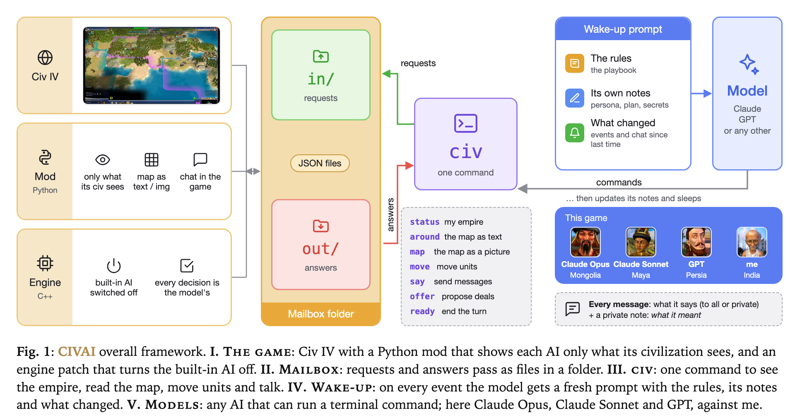

# CIVAI — LLMs play Civilization IV against you



CIVAI lets Claude, GPT, DeepSeek or any other model that can run a terminal command play a civilization in
**Civilization IV: Beyond the Sword**. The game's built-in AI is switched off for those civilizations, so every
decision is the model's. You play your own civilization as usual, and you can talk to them in the game chat:
make deals, build coalitions, lie, or get lied to.

- **Fair.** Each model sees only what its civilization sees: the same fog of war as a human.
- **Full control.** Anything a human can do, from grand strategy down to a single worker, through one command, `civ`.
- **Talks in the game.** Public and private messages, trade offers, votes. Every message also comes with a private note of what the model meant.
- **Remembers.** Each model keeps its own notes (persona, plan, dossiers on the others, secrets) between wake-ups.

## How it works

1. **The game.** A Python mod (`mod/CIVAI`) collects only what an AI's civilization can see, and draws the map as text or as a picture. A patched game engine (`engine/`) turns the built-in AI off for the model's civilization.
2. **The mailbox.** The mod and the models talk through a folder: requests go in, answers come out, as JSON files.
3. **`civ`.** One command to see the empire, read the map, move units, send messages, offer deals and end the turn.
4. **Wake-ups.** On every event (a new turn, a message, a deal) the model wakes up with a fresh prompt: the rules (`PLAYBOOK.md`), its own notes, and what changed since last time. It makes its moves, updates its notes and goes back to sleep.
5. **Models.** `multi.py` runs one loop per seat; a seat can be Claude (Claude Code), GPT (Codex) or any model through [pi](https://github.com/badlogic/pi-mono) (DeepSeek and others).

## Requirements

- Civilization IV: Beyond the Sword (tested with the GOG *Complete* edition, patch 3.19).
- Developed and tested on a Mac with CrossOver; on Windows the paths in `install.sh` need changing.
- Python 3.10+.
- At least one agent CLI: [Claude Code](https://docs.claude.com/en/docs/claude-code), [Codex](https://github.com/openai/codex) or pi. A subscription works; nothing needs an API key.
- For the engine patch: Firaxis' BtS 3.19 SDK and MSVC 7.1 (see `engine/README.md`). Without it the mod still runs, but the built-in AI keeps making some choices for the model's civilization.

## Quick start

```bash
./install.sh                       # copy the mod into the game (CrossOver bottle "civ4"; set CIV_BOTTLE otherwise)
./newgame.py my-game new           # then Custom Game in Civ IV with the CIVAI mod: the game asks which model plays each leader
./newgame.py my-game start         # once the map is on screen: starts the broker and one loop per model
./multi.py my-game status          # who is running, each seat's last wake-up
./multi.py my-game stop
```

Logs, notes and every model's messages (with what it meant) are kept per game in `games/<id>/`. `metrics.py <id>`
prints the numbers of a game: wake-ups, thinking time, messages, deals and cost at API prices.

## Layout

| | |
|---|---|
| `mod/CIVAI` | the Civ IV mod (Python): the bridge, fog-of-war views, chat |
| `engine/` | the engine patch that hands decisions to the model, and how to build it |
| `civ` | the command the models use |
| `broker.py`, `loop.py`, `multi.py` | requests to the game, the wake-up loop of one seat, the runner of all seats |
| `PLAYBOOK.md` | the rules every model gets |
| `newgame.py`, `rewind.py`, `replay.py` | start a game, rewind it, replay recorded commands |
| `SPEC.md` | the design |
